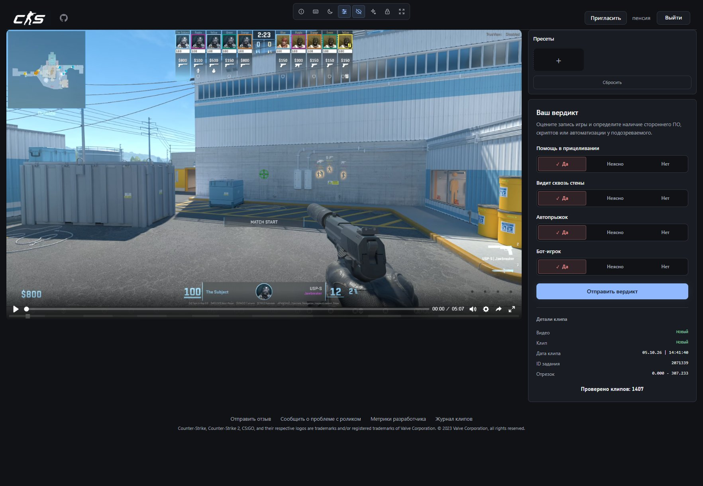
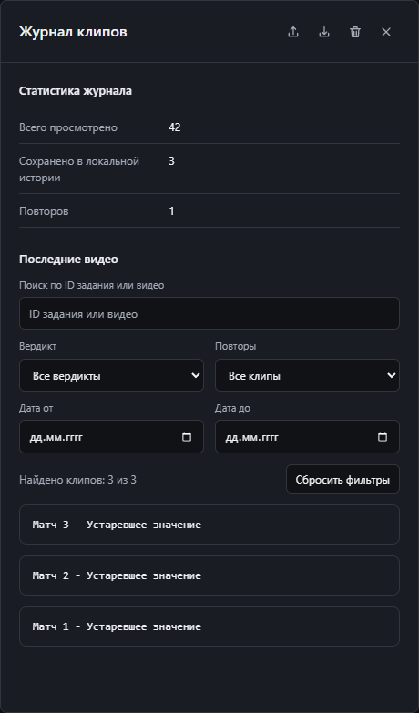
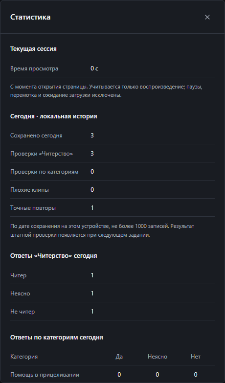
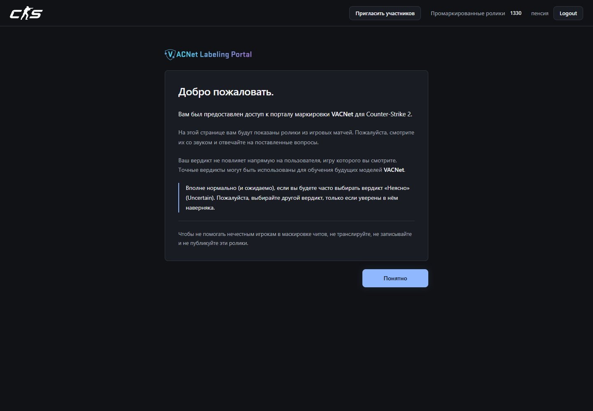
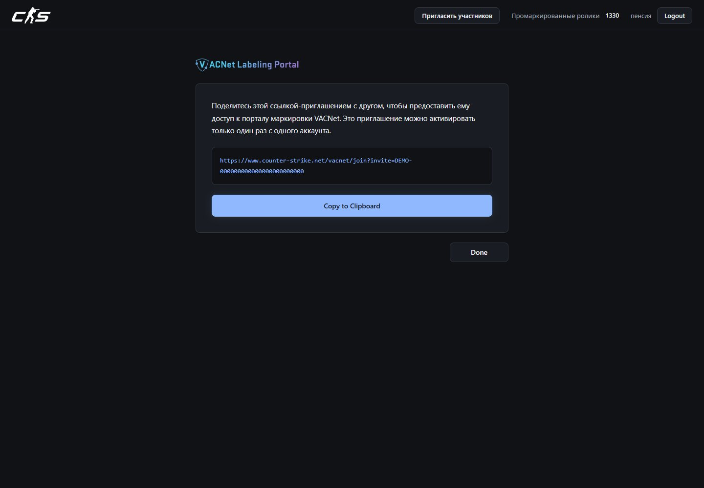

<h1 align="center">VacNet++</h1>

<b>Watch closely. Find faster. Review comfortably.</b>

A browser extension for the Counter-Strike 2 VACNet portal. A dark theme, Plyr player, verdict presets, searchable history, and viewing statistics.

  
  
  
  

  <a href="https://github.com/pensiya5/VacNetPlusPlus/releases/latest"><b>Download</b></a> &nbsp;·&nbsp;
  <a href="#features"><b>Features</b></a> &nbsp;·&nbsp;
  <a href="#installation"><b>Installation</b></a> &nbsp;·&nbsp;
  <a href="../../README.md"><b>Русский</b></a>

Graphite surfaces, an ice-blue accent, and a soft glow. Review interface shown from version 4.2.0.

## Features

| | What VacNet++ offers |
| :--- | :--- |
| **🎬 Plyr player** | Playback at 0.25–4× speed, frame stepping, 2× zoom, and keyboard controls. Resume playback after choosing a verdict. |
| **🎯 Two review formats** | One Cheating / Uncertain / No cheating question for new clips; Aim Assist, Wall Hack, Auto BHop, and Bot categories for legacy clips. |
| **⚡ Verdict presets** | Up to nine saved answer sets, number-key shortcuts, and optional instant submission for each preset. |
| **📚 Clip history** | Up to 1,000 tasks grouped by match. Search task or video IDs; filter by verdict, repeats, and dates. Import and export JSON. |
| **📊 Statistics** | Today's saved reviews, answer distributions, and actual session playback time excluding pauses, seeking, and buffering. |
| **🔎 Developer metrics** | Clip and player details, review format, submission state, selected answer, decision tick, and decision time. |
| **🔄 Update checks** | Automatic stable-release checks and a manual button in the bottom-left corner. Updates are installed manually. |
| **🌙 Consistent design** | A dark theme for reviews, presets, history, metrics, welcome, and invitation pages. Animated answer selection and reduced-motion support. |

**Open history, metrics, and statistics from the footer.** Their panels share the same theme and adapt to the window size. The extension interface currently uses Russian.

## Screenshots

### History and statistics

<table>
  <tr><td width="50%" align="center"><b>Search and filters</b></td><td width="50%" align="center"><b>Daily reviews and session time</b></td></tr>
  <tr>
    <td valign="top"></td>
    <td valign="top"></td>
  </tr>
</table>

Panels captured from the built 4.5.0 extension with demonstration records.

### Welcome and invitations

<table><tr>
  <td width="50%"></td>
  <td width="50%"></td>
</tr></table>

Page examples from version 4.2.0. The invitation link is a demo.

## Installation

> You need existing access to the official VACNet portal. This extension does not grant review access.

### Chrome, Edge, Brave, and other Chromium browsers

1. Open the [latest release](https://github.com/pensiya5/VacNetPlusPlus/releases/latest) and download the **`-chrome.zip`** archive.
2. Extract it into a permanent folder.
3. Open `chrome://extensions` (`edge://extensions` in Edge) and enable **Developer mode**.
4. Click **Load unpacked** and select the folder containing `manifest.json`.
5. Open or reload the VACNet page.

<b>Firefox 128 and newer</b>

Download and extract **`-firefox.zip`**. Open `about:debugging#/runtime/this-firefox`, choose **Load Temporary Add-on**, and select `manifest.json`.

Repeat temporary installation after restarting Firefox. Permanent installation requires a signed package. The local build has its own extension ID; use history export and import to transfer records from another add-on.

**Updating:** replace the files in the same extension folder, reload the extension from its card, and refresh VACNet. Keep the existing folder; you can export history before updating.

## Keyboard shortcuts

| Key | Action |
| :--- | :--- |
| **Space** | Play / pause |
| **← / →** | Previous / next frame |
| **[ / ]** | Decrease / increase speed |
| **R** | Return to the start |
| **Z** | Toggle 2× zoom |
| **E** | Jump to a marked event, when available |
| **1–9** | Apply a saved preset |
| **Enter** | Submit or confirm when available |
| **Esc** | Close an open panel |

Shortcuts do not control the video while typing or using dialogs. Presets with instant submission enabled immediately send their saved answers.

## Good to know

- **New-format history** is saved when the next task opens in the same tab. Until then, a record stays pending for up to 10 minutes.
- **Daily statistics** use saved history rather than your account's lifetime review total. Session playback time resets when the page opens.
- **Local data:** settings, presets, and history stay in browser storage. No analytics or telemetry. Update checks contact GitHub without sending history or verdicts.
- **Exports and guest links** may contain access parameters. Do not publish them in reports or screenshots.

## Development and feedback

From the cloned repository root, run `cd extension` first. Then use Node.js 22.12+ and npm: `npm ci`, followed by `npm run check`. For browser checks, run `npx playwright install chromium` and `npm run check:all`. Detailed build and Windows instructions are in the [development guide (Russian)](DEVELOPMENT.md).

Found a bug or have an idea? Open an [issue](https://github.com/pensiya5/VacNetPlusPlus/issues). Browse all [releases](https://github.com/pensiya5/VacNetPlusPlus/releases).

VacNet++ helps people review replays; it does not detect cheats on its own. This project is not affiliated with Valve Corporation. Counter-Strike and VACNet are trademarks of Valve Corporation.

<a href="../../LICENSE">GPL-3.0</a> &nbsp;·&nbsp; <b>VacNet++ 4.5.0</b>

